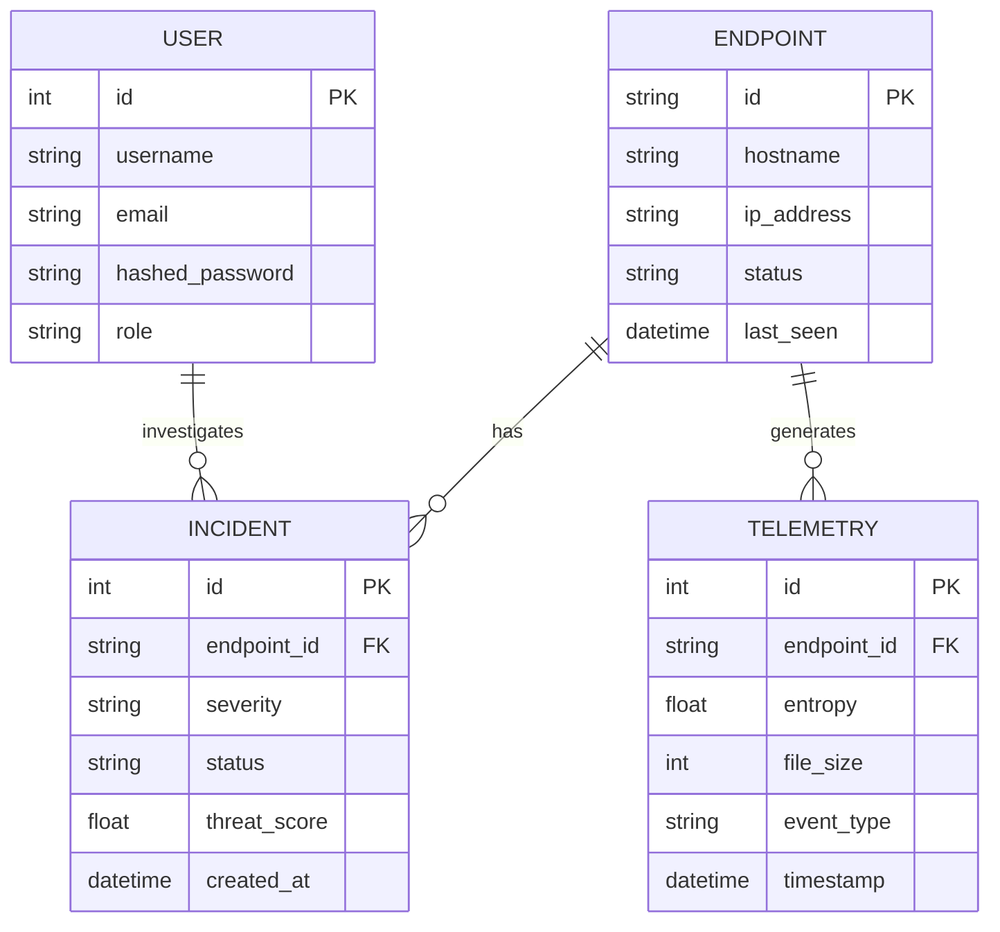
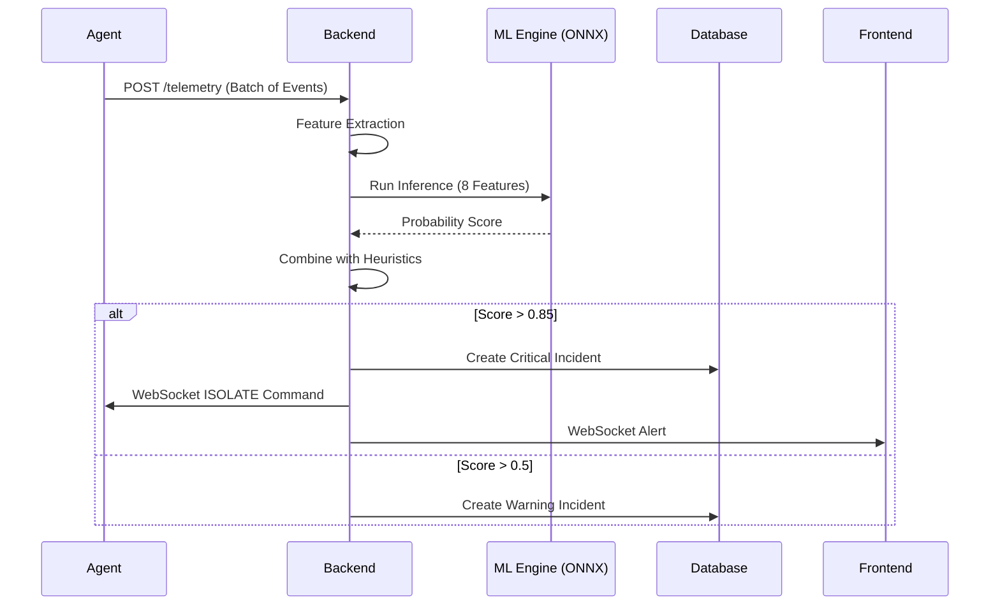
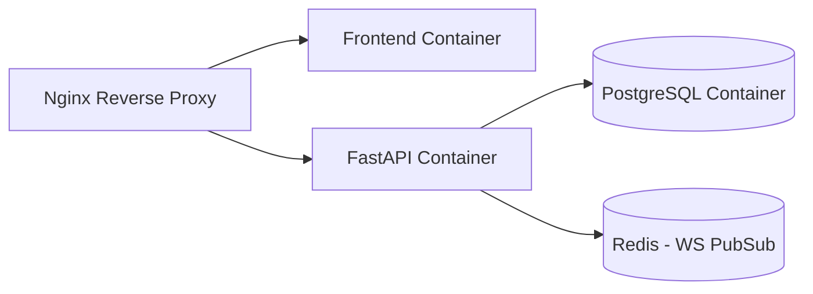

# RansomGuard Architecture

This document outlines the high-level architecture and component interactions of the RansomGuard system.

## System Overview

```mermaid
flowchart TD
    User([Security Analyst]) -->|HTTP/WS| Frontend
    
    subgraph Frontend [React SOC Dashboard]
        UI[UI Components]
        State[State Management]
        Copilot[RansomGuard Copilot]
    end
    
    Frontend -->|REST| API Gateway
    Frontend -->|WebSocket| WSManager
    
    subgraph Backend [FastAPI Server]
        API Gateway --> Auth[Auth & RBAC]
        API Gateway --> Routers[API Routers]
        WSManager[WebSocket Manager]
        
        Routers --> Services
        Services --> DB[(Database)]
        Services --> ML[ML Engine]
        Services --> SimLab[Simulation Lab]
    end
    
    subgraph Endpoints [Monitored Endpoints]
        Agent[Endpoint Agent]
        Watchdog[File Watchdog]
    end
    
    Agent -->|Telemetry| API Gateway
    Agent -->|Heartbeat| API Gateway
    WSManager -->|Isolate Command| Agent
```

## Component Breakdown

### 1. Backend (FastAPI)
The core server handles REST API requests, WebSocket connections, database interactions (SQLAlchemy), and authentication (JWT). It orchestrates ML inference and endpoint management.

### 2. Frontend (React 18+)
A dark-themed SOC (Security Operations Center) dashboard built with Vite, Tailwind CSS, and Recharts. Provides real-time views of active endpoints, incidents, model metrics, and includes an integrated Copilot chatbot.

### 3. ML Pipeline (PyTorch)
A sequence-based anomaly detection engine using LSTM. It processes time-series telemetry to detect ransomware-like behavior. Models are trained in PyTorch and exported to ONNX for efficient inference.

### 4. Endpoint Agent
A lightweight client running on protected machines. It uses file system watchdogs to monitor events, calculates local telemetry (e.g., entropy), and sends data to the backend. It also listens for isolation commands.

### 5. Simulation Lab
A controlled environment within the backend to generate synthetic ransomware behaviors (encryption, renaming, rapid deletion) against dummy files. Used for demonstrating detection capabilities and model evaluation.

## Database Schema



## Security Architecture

- **Authentication:** Stateless JSON Web Tokens (JWT) issued upon login.
- **Authorization:** Role-Based Access Control (RBAC). Admin roles required for model management and agent isolation.
- **Passwords:** Hashed using bcrypt with salt.
- **Endpoint Comm:** Agent telemetry is authenticated using endpoint-specific API keys.

## WebSocket Communication Protocol

WebSockets are used for bi-directional real-time updates.
- **Server -> Frontend:** Streams new incidents, endpoint status changes, and active telemetry.
- **Server -> Agent:** Sends immediate auto-containment/isolation commands if an anomaly score exceeds the critical threshold.

## ML Inference Pipeline Flow



## Deployment Architecture

The application is containerized using Docker and orchestrated with Docker Compose.


